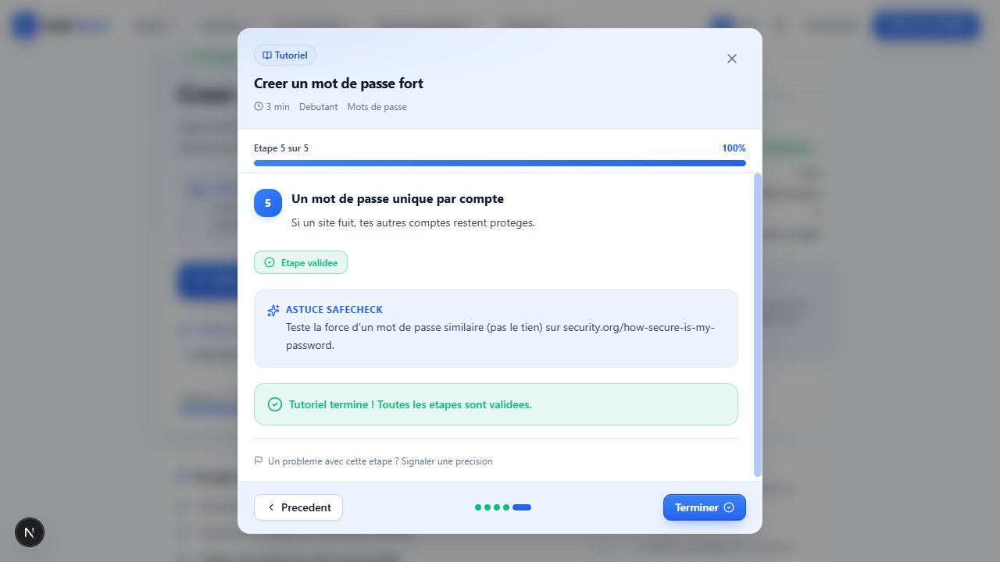

# TUTO 3B — lecteurs et catalogue en mémoire

## Contrat et périmètre

Les pages `/tutoriels` et `/tutoriels/[id]` possèdent chacune leur session React,
indexée par identifiant de tutoriel via `useTutorialProgress`. `session.ts` adapte
le domaine `progress.ts` aux statuts des cartes et normalise chaque mise à jour.
Le lecteur partagé `TutorialModal` utilise le domaine pour toutes ses mutations,
statuts, validations et pourcentages. Aucun booléen `markedDone` ne subsiste.

Une carte ou une fiche affichée ne crée aucune progression. Commencer crée une
progression vide ; rouvrir conserve la position et les validations. Précédent,
Suivant et les points de navigation déplacent uniquement la position. Terminer
valide toutes les étapes puis ferme le lecteur. Fermer seul ne complète rien.
Toutes les validations suffisent à compléter ; en retirer une décomplète.

Les vues catalogue, personnalisée et par niveau, leurs cartes, filtres, recherche,
compteurs et section de reprise consomment la session. La fiche détail consomme
la même logique ; `saved` garde son comportement local séparé.

Guest et User utilisent exactement la même mémoire, sans User.id, appel API de
progression, provider global, cookie, stockage navigateur ou encodage URL.
Rechargement/F5 ou démontage lors d'un changement complet de route : perte de la
session, **EXPECTED UNTIL TUTO 5/6**. Aucune synchronisation catalogue/détail.

## Recette navigateur du 2 octobre 2026

Tutoriel 2, « Creer un mot de passe fort », cinq étapes, testé dans les deux modes.

| Scénario | Résultat observé |
| --- | --- |
| A — Commencer | CTA Commencer initial ; progression en cours après lancement |
| B — Navigation | Étape 5/5 sans validation : 0 %, sans complétion |
| C — Validation partielle | Étapes 1 et 2 validées : 40 %, étape affichée 3 |
| D — Réouverture | Étape 3 et validations conservées après fermeture/réouverture |
| E — Terminer | Toutes les étapes validées, 100 %, CTA Revoir |
| F — Validation manuelle | Les cinq étapes cochées individuellement : 100 %, complété sans Terminer |
| G — Décomplétion | Décocher une étape après complétion : 80 %, en cours |
| H — Revoir | Réouverture et consultation d'un tutoriel terminé possibles |
| I — F5 | Retour à Commencer, aucune progression/reprise conservée |

Compléments : tutoriel 3 à 20 %, étape 2, puis tutoriel 2 neuf à 0 %, étape 1 :
isolation des sessions par identifiant confirmée. Filtre A faire : démarrer retire
immédiatement la carte ; En cours la retrouve ; Terminé ne montre que le tutoriel
effectivement complété. Fermer après disparition du déclencheur restitue le focus
au main du catalogue. Le doublon Reprendre conditionnel du détail est retiré ;
le CTA principal stable conserve la restauration de focus.

La modale de précision reste distincte : Échap ferme la précision et restitue le
focus dans le lecteur. Aucun formulaire envoyé. Contrôle visuel du lecteur en
1280 × 720 et 390 × 844, thèmes clair et sombre : actions accessibles, progression
et message de complétion lisibles. Aucun avertissement/erreur console observé.
Recette interactive en guest ; égalité User/Guest vérifiée dans le code commun,
sans scénario de connexion navigateur ajouté pour cette tâche.

## Vérifications

- Nouveaux tests de session : 8/8 (CTA, reprise, isolation, filtres/recherche,
  remise à zéro et normalisation).
- Domaine progression : 32/32 ; intégrité tutoriels : 29/29.
- Unitaires : 107/107 ; intégration : 13/13 ; suite complète : 120/120,
  zéro ignoré, échec ou annulé.
- Typecheck, lint, build et git diff --check exécutés avec succès.
- Audit Astra en lecture seule, effort High : deux cas de focus corrigés,
  aucun autre écart métier signalé.
- Aucun changement TUTO 3B à Prisma, aux migrations, au backend ou à l'API.
  Les tests d'intégration existants créent et nettoient leurs données temporaires.

## Usages résiduels actifs

`userProgress` pilote encore la démonstration de niveau, badges, statistiques,
progression agrégée, prochain niveau et comparaison dans `TutorialProgressionHero`,
et la sélection de niveau dans `TutorialPersonalizedView`. Le hero affiche
explicitement « Apercu de demonstration : niveau, badges et statistiques simules. »
Ces valeurs ne décrivent pas les validations réelles de la session.

Le catalogue reste statique (34 tutoriels). Favoris, commentaires, retours et
personnalisation gardent leurs simulations existantes. Aucun arbitrage éditorial
Recommended/Essential/Popular ni persistance ajouté dans cette tâche.

`mockTutoStatus` et `mockTutoLastStep` restent déclarés pour les tests d'intégrité
statique ; aucun composant actif ne les importe pour ses actions ou sa progression.

## Suite

TUTO 4 — définir puis créer le schéma Prisma minimal UserTutorialProgress et sa
migration, sans encore connecter le frontend à l'API.
