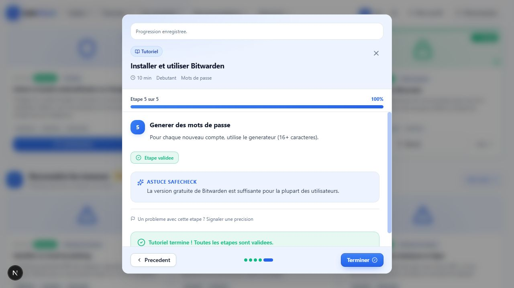

# TUTO 6A — Persistance frontend des progressions Tutoriels

Recette réalisée le 2 octobre 2026 sur le frontend local, l'API Fastify existante
et PostgreSQL. Le catalogue, le lecteur et le détail utilisent les progressions
réelles du User. Les Guests conservent uniquement un état de page en mémoire.
Les pages Compte et Résultats n'ont pas été modifiées pendant cette étape.

## Architecture

`AuthProvider → useTutorialProgress → contrôleur de page → file PUT → API`.

- L'identité reste issue de Better Auth. `undefined` signifie Auth en cours,
  `null` Guest, et une chaîne l'identifiant du User.
- Le helper API utilise `NEXT_PUBLIC_API_URL`, `credentials: include`,
  `cache: no-store` et un signal d'annulation. Le corps PUT ne contient que
  `currentStep` et `completedSteps`. Aucun `userId` n'est envoyé.
- Un GET charge toutes les progressions une fois par hydratation de page.
  Le catalogue statique fournit les contenus et le domaine normalise les
  positions/validations. Les entrées malformées provoquent une erreur ; un
  résultat réellement vide reste distinct de cette erreur.
- Les actions restent indisponibles pendant Auth/loading/erreur GET. Le GET
  d'une identité quittée est annulé et sa réponse tardive ignorée.
- Après hydratation, le contrôleur de page porte l'état interactif, observé
  par React via `useSyncExternalStore`. Chaque mutation effective produit
  immédiatement un nouveau snapshot local puis une sauvegarde.
- Les ouvertures sans changement n'effectuent pas de PUT. La consultation du
  catalogue ne crée aucune progression.
- La file contient une chaîne de promises par tutoriel, avec copie du snapshot
  à l'enqueue. B ne démarre qu'après la résolution/rejection de A ; un échec
  n'empoisonne pas les prochaines sauvegardes. Deux tutoriels sont indépendants.
- Seul le transport des écritures en vol survit à un changement de route, sans
  provider global ni cache global des progressions. La page destination attend
  la fin des écritures de la page source, puis recharge la DB.
- Une réponse PUT ne remplace jamais l'état interactif. Les révisions locales
  empêchent une ancienne réponse de modifier l'état d'erreur d'un snapshot récent.
- Après échec PUT, l'état local reste intact ; Réessayer envoie le snapshot
  courant complet. Une action suivante peut aussi récupérer la sauvegarde.
- Les changements d'identité masquent immédiatement l'ancienne map et ses
  modales. Le cycle Auth annule les anciennes requêtes avant de changer les
  cookies ; les jobs encore en attente ne peuvent pas partir sous une nouvelle
  session. Guest → login charge le serveur sans claim de progression Guest.

## Recette navigateur A à J

Tutoriel utilisé : 3, Installer et utiliser Bitwarden, cinq étapes.

| Cas | Observation réelle |
| --- | --- |
| A — Commencer | Compte A vide à la consultation du catalogue : aucune ligne créée. Commencer, valider deux étapes, avancer : DB `currentStep=2`, `completedSteps=[0,1]`, UI étape 3/5 et 40 %. |
| B — F5 | Réouverture via Reprendre : étape 3/5, 40 %, deux validations restaurées. |
| C — Routes | Catalogue → détail : En cours (40 %), deux étapes complétées, reprise à l'étape 3. Détail → catalogue : Reprendre conservé depuis la DB. |
| D — Clics rapides | Suivant, Précédent, toggle, Suivant, toggle, Précédent : état final DB `currentStep=2`, `[0,1,2,3]`. Après F5 : étape 3/5 et 80 %, état identique. |
| E — Terminer | Navigation directe étape 5 puis Terminer : après F5, Revoir, 100 %, cinq validations et message Tutoriel terminé. |
| F — Décompletion | Décocher la dernière étape : après F5, Reprendre, étape 5/5, 80 %, `[0,1,2,3]`. |
| G — Logout | Depuis A terminé, déconnexion : disparition immédiate des validations et du statut terminé ; Guest affiche Commencer. |
| H — Compte B | Connexion B : Commencer, aucun Reprendre/Revoir et aucune ligne DB appartenant à B. Aucune progression de A visible. |
| I — Guest | Commencer, valider et avancer : étape 2/5 et 20 %. Les logs API de cette séquence contiennent uniquement les appels Auth, aucun GET/PUT progression. Après F5 : Commencer, état perdu. Un nouvel avancement Guest avant login A n'a créé ni transféré de ligne DB. |
| J — Panne PUT | API arrêtée pendant le lecteur : toggle à 100 % conservé localement, alerte Sauvegarde impossible et Réessayer accessible dans la modale. API relancée, réessai : Progression enregistrée et DB `currentStep=4`, `[0,1,2,3,4]`. |

Contrôle supplémentaire GET : API arrêtée, navigation client vers le détail en
gardant la session A résolue. Message Impossible de charger vos progressions,
aucun faux Commencer et aucune action de progression disponible. Retour API,
Réessayer : détail et lecteur restaurés à 100 %.

Contrôles visuels : 1280×720 et 390×844, thèmes clair et sombre, lecteur et
bandeau lisibles sans débordement horizontal. Échap ferme le lecteur et rend le
focus au déclencheur. Aucun avertissement React observé. Deux avertissements
du mécanisme préexistant de claim des audits Guest sont apparus au login ; ils
ne concernent pas les progressions Tutoriels et ce code n'a pas été changé.

Preuve du lecteur enregistré :

## Tests

20 nouveaux tests, sans framework React ni dépendance ajoutée :

- hydratation/normalisation et distinction entre vide et payload malformé ;
- A lent puis B, tutoriels indépendants, snapshot copié, récupération après
  rejection, annulation des jobs lors d'un changement Auth ;
- Guest/Auth sans appels, blocage pendant GET, erreur GET et réessai,
  logout/réponse tardive, A → B, absence de claim Guest ;
- UI optimiste conservée, réessai du snapshot complet, réponses PUT anciennes
  sans écrasement local, continuité des écritures entre routes, réouverture sans PUT ;
- helper API : configuration, credentials/cache, payload exact et erreurs HTTP.

Unitaires : **136/136**. Intégration existante : **43/43**.
Suite `npm test` : **179/179**, zéro échec, zéro test ignoré.
`npm run typecheck`, `npm run lint`, `npm run build` et `git diff --check` :
réussis. Build de production : 20 pages générées, route détail dynamique.

## Périmètre et données de recette

Aucune modification du backend TUTO 5, du schéma Prisma ou des migrations.
Aucune dépendance nouvelle, aucun stockage navigateur de progression, aucun
claim de progression Guest et aucun provider global de progression.

Les deux comptes de recette manuelle sont conservés, conformément à la consigne
de ne nettoyer que les fixtures automatisées. Identifiants de contrôle :

- A : `h7xsV2JDyml4Qzj9IT6hIxuud67pASZX` ; progression finale tutoriel 3,
  `currentStep=4`, `completedSteps=[0,1,2,3,4]`.
- B : `yluBBitq4w2UZhzNjqA9HwJhSDSQUySB` ; aucune progression.

Les tests d'intégration nettoient leurs propres fixtures. Les scripts temporaires
de recette ont été retirés ; les serveurs temporaires et l'onglet de test ont été
fermés. Les changements préexistants du workspace ont été conservés.

## Limites de persistance restantes

- La file ordonne les mutations dans ce frontend. Plusieurs onglets/appareils
  restent soumis au last-write-wins du backend, sans résolution de conflits.
- Il n'existe pas de stockage hors ligne durable : fermer/recharger une page
  avec une sauvegarde échouée ou encore non confirmée peut perdre ce snapshot.
  La garantie F5 porte sur les sauvegardes confirmées par Progression enregistrée.

## Étape suivante

TUTO 6B — reconnecter la page Compte aux progressions Tutoriels réelles et afficher les tutoriels en cours / terminés.
