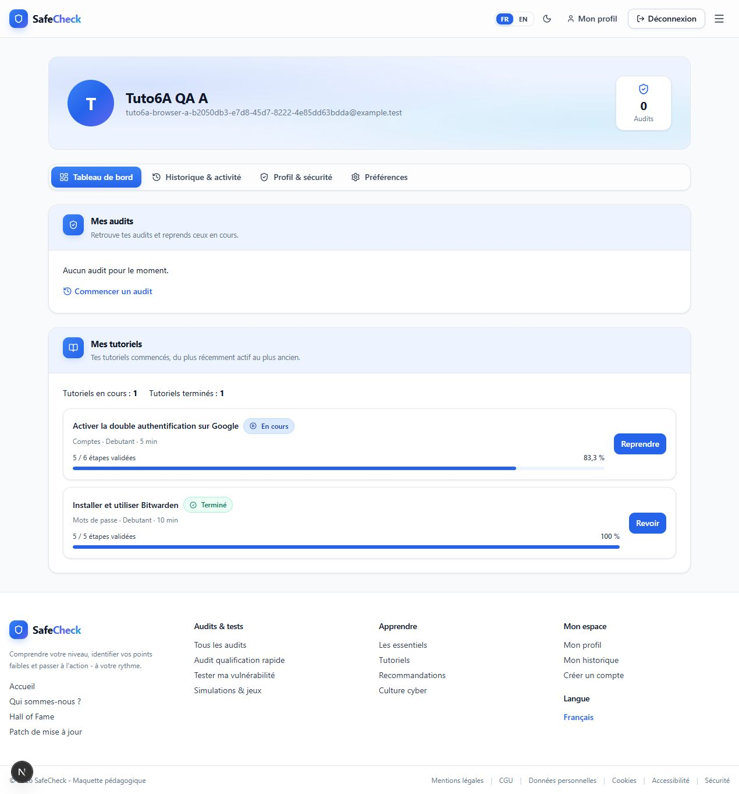

# TUTO 6B — Compte et progressions Tutoriels réelles

Recette du 2 octobre 2026 sur le frontend local, l'API Fastify existante et
PostgreSQL. La section **Mes tutoriels** se trouve dans le tableau de bord du
Compte, sous **Mes audits**. Le design du Hero et l'historique Audit restent
inchangés.

## Tests first

Avant toute modification des composants Compte :

1. Définition du contrat `AccountTutorial` et des primitives pures
   `mapAccountTutorials` / `calculateTutorialCounters`.
2. Écriture de huit tests ; exécution : **0/8**, échecs attendus sur les stubs.
3. Implémentation des transformations ; exécution : **8/8**.
4. Ajout d'un test du client partagé pour conserver les timestamps API ;
   première exécution en échec, puis succès après extension du client.
5. Exécution des transformations et des tests de persistance existants :
   **29/29**, avant de connecter React.
6. Ensuite seulement, création du composant et raccordement de `/compte`.

Les huit tests couvrent : mapping partiel et métadonnées canoniques, completion
et CTA, délégation du pourcentage/statut au domaine, tri chronologique
`updatedAt DESC` y compris des offsets différents, ID inconnu ignoré, liste
vide, compteurs, absence de mutation. Ils ne reproduisent pas les invariants
internes de `progress.ts`.

## Sources et chargement

- GET existant `/me/tutorial-progress`, credentials inclus, configuration
  `NEXT_PUBLIC_API_URL`, validation de réponse partagée et cache désactivé.
- `getTutorialProgressSnapshots` expose les DTO validés, avec leurs véritables
  timestamps. Le client du lecteur conserve son contrat précédent.
- `tutorialId` résout le tutoriel dans l'adaptateur du catalogue canonique.
  Aucune métadonnée copiée dans un mock. Les IDs inconnus sont ignorés.
- Normalisation, statut et pourcentage passent par le domaine Tutoriels existant.
  `currentStep` ne sert pas de numérateur au pourcentage.
- Seules les progressions présentes sont affichées, triées par activité récente.
  Les compteurs de section distinguent en cours et terminés.
- Les CTA utilisent les routes actuelles `/tutoriels/<id>`, sans étape ni mode
  review dans l'URL. Le détail restaure lui-même les données via TUTO 6A.
- Le chargement Tutoriels est indépendant de celui des Audits. Il attend les
  PUT Tutoriels en vol avant son GET, pour fiabiliser un retour rapide du lecteur.
- Le contenu Compte reste monté uniquement après Auth, avec une clé par User.
  Le cleanup annule le GET et ses callbacks ignorent les réponses tardives.
- `null` signifie chargement, `[]` succès vide, et l'erreur expose Réessayer.
  L'erreur Tutoriels ne change ni l'identité ni les états Audit.
- Aucune date de completion affichée ou inventée.

## Recette navigateur A à I

Les comptes A/B conservés depuis la recette 6A ont été réutilisés. B n'avait
aucune progression ; A possédait Bitwarden terminé. Le tutoriel Google (ID 1,
six étapes) a été commencé depuis le navigateur pendant cette recette.

| Cas | Résultat observé |
| --- | --- |
| A — Compte vide | B : Aucun tutoriel commencé pour le moment, CTA Voir les tutoriels vers `/tutoriels`. Aucun tutoriel fictif affiché. |
| B — IN_PROGRESS | A commence Google, valide deux étapes et atteint l'étape index 2. Compte : 2/6, 33,3 %, En cours, Reprendre. |
| C — Reprendre | Lien Compte → `/tutoriels/1`, reprise du lecteur à l'étape 3/6 avec deux validations. |
| D — COMPLETED | Terminer depuis l'étape 6 : retour Compte, 6/6, 100 %, Terminé, Revoir. |
| E — Décompletion | Revoir puis décocher la dernière étape : retour Compte, 5/6, 83,3 %, En cours, Reprendre. |
| F — Plusieurs | Google et Bitwarden visibles ; Google plus récent en premier. Compteurs : un en cours, un terminé. Le contrôle Prisma confirme l'ordre par updatedAt. |
| G — F5 Compte | Même liste, même ordre, mêmes pourcentages et CTA restaurés. |
| H — Isolation | Logout A puis login B : identité B et état vide, aucun item de A. |
| I — Erreur API | 503 contrôlé uniquement sur le GET Tutoriels : erreur avec Réessayer dans la section, identité A et Audits disponibles. Navigation Historique Audit fonctionnelle. Après retrait de la panne, réessai : données Tutoriels restaurées. |

La panne a été injectée dans une instance QA temporaire du serveur existant,
depuis un script ignoré dans `.next`, sans modifier les sources backend, sans
ajouter d'endpoint et sans arrêter Auth/Audits. Les logs confirment GET progression
503 et GET Audits 200. Le script et son marqueur ont été retirés après la recette.

Thèmes clair/sombre et tailles desktop 1280×720 / mobile 390×844 contrôlés.
Les CTA sont accessibles au clavier, avec focus visible ; les cartes se replient
sans débordement horizontal. Aucun avertissement React nouveau observé.
Les avertissements préexistants du claim des audits Guest au login restent hors
du périmètre de cette étape.

## Mocks

- `mockTutos` n'avait plus de consommateur applicatif : suppression de la donnée,
  du type de statut propre à ce mock et de sa référence au test de sérialisation.
- `mockGuides` est conservé, hors scope, et ne nourrit pas la section réelle.
- `userProgress` reste simulé dans les vues Tutoriels de démonstration ; il
  n'alimente ni les données ni les compteurs de la section Compte.
- Aucun raccordement de badges, niveau utilisateur, favoris ou recommandations.

## Validation

- Nouveaux tests : **9**.
- Unitaires : **145/145**.
- Intégration : **43/43**.
- Suite `npm test` : **188/188**, aucun échec ni test ignoré.
- Typecheck et lint : réussis.
- `npm run build` : réussi, 20 pages générées et détail Tutoriel dynamique.
- `git diff --check` : réussi ; fichiers non suivis contrôlés également sans
  erreur d'espacement.
- Backend, schéma, migrations, tables, colonnes et endpoints : aucune modification.
- Les changements préexistants du workspace ont été conservés.

Progressions manuelles finales conservées : A, tutoriel 1, `currentStep=5`,
`completedSteps=[0,1,2,3,4]` ; A, tutoriel 3, `currentStep=4`,
`completedSteps=[0,1,2,3,4]` ; B, aucune progression. Les fixtures automatisées
nettoient uniquement leurs propres données. Les serveurs et l'onglet temporaires
ont été fermés.

## Hors MVP

Pas de synchronisation automatique avec les autres onglets/appareils pendant que
le Compte reste ouvert. Un nouveau montage ou F5 recharge les données. Les
limites de conflits last-write-wins et de stockage hors ligne de TUTO 6A restent
inchangées.

## Étape suivante

TUTO 7 — recette et stabilisation finale du parcours Audit → Résultats → Recommandation → Tutoriel → progression → Compte.
