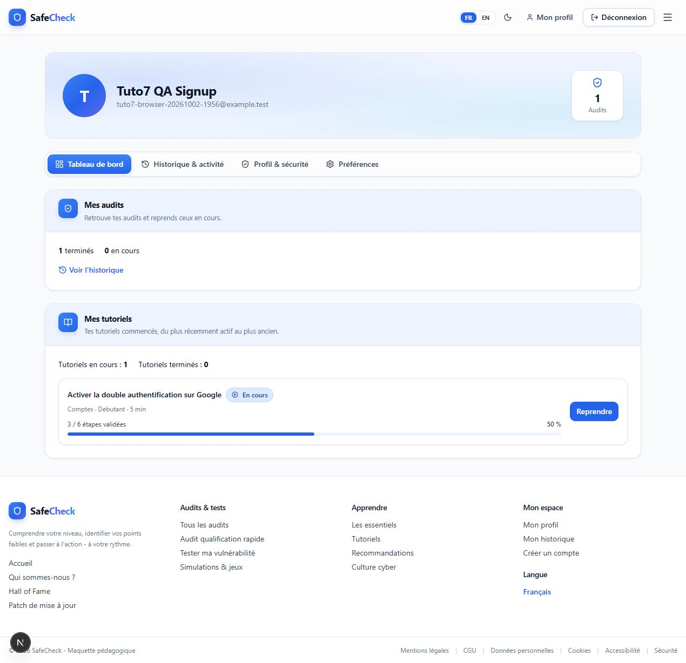

# TUTO 7 — Stabilisation finale Audit → Tutoriel → Compte

Recette navigateur effectuée les 2–3 octobre 2026 ; vérifications techniques
finalisées le 5 octobre 2026 après interruption. Résultat : SUCCESS WITH DEBT.
Verdict : GO pour la verticale MVP ; aucun P0 ouvert constaté.

## Périmètre et modifications

Inspection limitée aux jonctions Audit, Résultats, Auth/claim, Tutoriels et Compte.
Aucune nouvelle fonctionnalité, infrastructure E2E, dépendance, migration ou API.
Les modifications préexistantes et celles apparues pendant l'interruption sont
conservées, notamment la sécurisation locale PostgreSQL d'un autre chantier.

Fichiers applicatifs modifiés par TUTO 7 :

- `src/components/safecheck/auth-logic.ts` : appel de fetch sans receiver imposé.
- `src/app/resultats/page.tsx` : chargement après hydratation Auth et nouvel état
  de Résultats à chaque changement d'identité.
- `src/features/recommendations/components/RecommendationsContent.tsx` : montage
  de la vue technique indexé sur la catégorie demandée par l'URL.
- `src/features/results/components/ResultsScoreHero.tsx` : badges fictifs retirés.
- `src/features/results/components/ResultsAssessment.tsx` : portée indicative
  des repères selon le score global explicitée.
- `src/features/tutorials/components/TutorialFeaturedSections.tsx` et
  `src/features/tutorials/data.ts` : suggestions générales, suppression de la
  prétendue personnalisation par le dernier audit.
- `tests/unit/auth.test.ts` : un test de non-régression.

## Bugs : observation, correction et retest

### T7-01 — P0, rattachement de l'audit Guest impossible dans le navigateur

Reproduction : login puis avertissement `guest audits could not be claimed` ;
aucun POST claim dans les logs serveur. `dependencies.fetcher(...)` transmet
l'objet dependencies comme receiver au fetch natif du navigateur.

Test écrit avant correction : callback strict refusant un receiver non undefined.
Exécution rouge : 9/10 tests Auth passent ; une alerte est émise et le callback
n'est pas exécuté correctement. Correction : variable locale `fetcher`, puis
appel sans receiver. Exécution verte : 10/10.

Retest réel : inscription depuis Résultats, POST `/audits/claim-guest` 200,
ancien audit transféré au nouveau User, guestSubject null, dix réponses et statut
COMPLETED conservés. Login existant également retesté sans avertissement.

### T7-02 — P1, Résultats chargés conservés lors du changement d'identité

Reproduction UI : après logout sur Résultats, les contrôles Auth deviennent Guest
alors que le score User est encore visible avant la redirection d'accueil.
Cause : état et GET dépendant uniquement d'auditId.
Correction : état de la page isolé par identité ; aucun chargement avant
hydratation Auth. Retest : logout ne laisse pas de score User, B reçoit
« introuvable ou inaccessible » pour l'audit A. Signup et pendingHref restent
fonctionnels. Correction React couverte par recette navigateur documentée ;
pas de test textuel artificiel ni de nouveau framework.

### T7-03 — P2, MINOR UI BUG, filtre technique périmé

Reproduction : Navbar → Système d'exploitation, puis Hardware. URL cat=hardware,
mais bouton Système pressé et quatre recommandations système affichées.
Cause : initialCat ne réinitialise pas l'état local d'une vue déjà montée.
Correction : clé React par catégorie URL. Retest sans F5 : Hardware pressé,
trois recommandations matériel, puis Logiciels pressé avec quatre recommandations.
Recette UI documentée ; filtre de niveau/urgence réinitialisé au changement de
catégorie par Navbar. Mapping des six destinations Résultats inchangé.

### T7-04 — P1, fausses données personnelles visibles

Reproduction : Résultats annonce « Badge 1 obtenu » sans acquisition persistée ;
catalogue complet affiche « Base sur votre profil et votre dernier audit » et
« Recommande apres votre audit » pour une sélection constante [1,3,5], y compris
Guest. Les points forts/faibles reposent sur le seul score global.
Correction : badges retirés de Résultats ; suggestions générales et motif
« Securiser son email » ; repères indicatifs explicitement signalés.
Retest UI desktop/mobile : badges absents, mentions corrigées présentes.
Pas de backend badges/recommandations ajouté.

## Parcours A — User connecté

Compte QA A existant utilisé. Nouvel audit avec userId A, guestSubject null,
dix réponses a, COMPLETED. Personnalisation passée : facultative et locale,
limitations clairement affichées. Résultats 100/100 rechargés par F5.

Recommandation mises à jour → `/tutoriels/mises-a-jour` → tutoriel canonique 7,
« Mettre a jour Windows ou macOS », cinq étapes, initialement NOT_STARTED.
Commencer, valider [0,1], position 2 : 40 %, restauré à l'étape 3 après F5.
Catalogue complet et Compte montrent les mêmes données ; reprise canonique /7.

Validation des cinq étapes → 100 %, Terminer, F5 → Revoir. Compte passe de
2 en cours/1 terminé à 1 en cours/2 terminés. Revoir ouvre le lecteur sans reset.
Dévalidation de la dernière étape → 80 %, F5 et Compte → Reprendre,
2 en cours/1 terminé. Historique Audit et Revoir Résultats restent fonctionnels.

## Parcours B — Guest → Signup → User

Nouvel audit Guest, userId null, guestSubject non null, dix réponses d,
COMPLETED, Résultats 0/100. Première recommandation → SignupModal, sans option
de login direct. Création du compte Tuto7 QA Signup : session confirmée,
claim 200, audit conservé et rattaché ; pendingHref →
`/tutoriels/double-authentification`, tutoriel canonique 1 Google.

Aucune progression héritée : Commencer puis deux validations, F5 → 33,3 %,
étape 3. Validation/dévalidation/validation rapide conserve le dernier état.
Après test de panne PUT et réessai, trois validations : 50 %. DB, détail et
Compte concordent. Historique du nouveau User montre l'ancien audit Guest ;
Revoir puis F5 restitue 0/100. Aucun claim de progression Guest créé.

Parcours C : le SignupModal Résultats ne propose pas le login existant.
Limite UX P2 conservée : fermer la modale puis utiliser Connexion Navbar est
possible, mais ne conserve pas la destination demandée par la modale.
Pas de reconstruction Auth. Les tests d'intégration existants couvrent le claim
avec compte existant ; login réel et appel claim ont également été observés.

## Isolation, logout, F5 et erreurs

- B : GET Audits et progression 200, listes vides dans Compte, aucun item A.
  Accès direct aux Résultats A refusé. Tests API ownership verts.
- Logout Compte : bloc personnel immédiatement masqué ; compte Guest redirigé
  vers accueil. Détail du tutoriel A en Guest : Commencer, aucune progression A.
- F5 : Résultats, catalogue, détail, Compte ; restauration réelle constatée.
- Panne GET progression 503 : erreur et Réessayer dans Mes tutoriels, Audits 200
  et historique utilisables. Réessai après retrait du marqueur restitue la liste.
- Panne PUT 503 : lecteur garde les trois validations/50 %, alerte explicite,
  Réessayer ; après retrait de la panne, sauvegarde puis F5 conserve 50 %.
- Panne GET audit 503 : message Résultats cohérent et Réessayer ; récupération
  à 0/100 après retrait de la panne.
- Navigation, validations rapides, ouverture/fermeture : aucun crash ni perte
  du dernier état observés. Submit standard validé ; pas de double submit forcé.

Pannes injectées par une instance temporaire du serveur existant avec hooks et
marqueurs dans `.next`, sans modifier les sources serveur ni ajouter d'endpoint.
Les scripts/marqueurs sont absents lors de la finalisation ; onglet et viewport
temporaire fermés/réinitialisés. Fixtures automatisées nettoyées par leurs tests.

Desktop contrôlé sur Audit, Personnalisation, Résultats, catalogue, détail,
Compte, Signup/Login. Mobile rapide 390×844 sur Résultats, lecteur, Compte :
aucun débordement horizontal, actions et textes accessibles. Console finale
sans erreur nouvelle observée. Pas de campagne responsive complète.

## Données manuelles conservées volontairement

Uniquement des comptes QA identifiables ; aucune donnée utilisateur supprimée.
Les mots de passe et cookies ne sont pas enregistrés dans ce rapport.

| Compte | Identifiant | Données |
| --- | --- | --- |
| Tuto6A QA A | h7xsV2JDyml4Qzj9IT6hIxuud67pASZX | Audit 91ce75ff-aa3a-4414-95b6-2271f6395e64, dix a, terminé. Nouveau tutoriel 7, currentStep 4, completedSteps [0,1,2,3], 80 %. Anciens tutoriels 1/3 conservés. |
| Tuto6A QA B | yluBBitq4w2UZhzNjqA9HwJhSDSQUySB | Aucun audit/progression lors de l'isolation. |
| Tuto7 QA Signup | IRFbVgY6tOsJwjt1AqhtB3Q75Y8ymHfm | Email tuto7-browser-20261002-1956@example.test ; audit claimé 0dbdcae7-27bf-4dfd-a6ab-7dba2f00e749, dix d, terminé. Tutoriel 1, currentStep 2, completedSteps [0,1,2], 50 %. |

## Vérifications finales

- Test TUTO 7 ajouté : 1 unitaire, rouge avant correction puis vert.
- Unitaires : 146/146 ; intégration actuelle : 44/44 ; total : 190/190.
- Aucun échec, test ignoré ou annulé.
- Au terme de la recette initiale : 189/189. Le test supplémentaire de permissions
  PostgreSQL présent à la reprise vient de l'autre chantier conservé.
- Typecheck, lint, build (20 pages), Prisma validate : réussis le 5 octobre.
- `git diff --check` : réussi.
- TUTO 7 : schéma, migrations et sources serveur inchangés ; comparaison SHA256
  serveur/prisma confirmée avant interruption. Aucun nouvel endpoint.

## Dette conservée

1. P1 : hors ligne, la progression non sauvée reste locale à la page ; fermeture
   ou rechargement avant sauvegarde peut la perdre, alerte et réessai existants.
2. P1 : échec réseau du claim n'annule pas Auth, avertissement console seulement ;
   cookie Guest conservé pour une tentative ultérieure. Pas de panne du claim
   observée après correction du receiver.
3. P2 : pas de login direct/pendingHref depuis SignupModal Résultats.
4. P2 : synchronisation multi-onglets/appareils sans temps réel, last-write-wins.
5. P2 : niveaux/statistiques/badges Tutoriels explicitement simulés ; popularité,
   favoris et feedback/commentaires hors verticale persistée.
6. P2 : recommandations et repères par score global, sélection générale dans
   le catalogue ; pas d'analyse personnelle de chaque réponse.

Ne pas ajouter maintenant de moteur de recommandation, backend badges/favoris/
commentaires, claim progression Guest, refonte Auth, stockage hors ligne global,
nouveau framework E2E ou migration.

GO — verticale Audit → Tutoriel → Compte stabilisée pour le MVP
